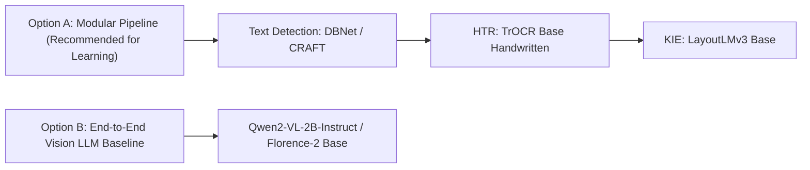

# Model Research: Text Detection, Handwriting Recognition, KIE & Vision LLMs

---

## 1. Overview of Model Categories

Building an end-to-end Handwritten Receipt Information Extraction pipeline requires models tailored for distinct tasks across the processing pipeline:

1. **Text Detection**: Locates where text exists on the receipt image and returns bounding box coordinates.
2. **Handwriting Recognition (HTR)**: Reads cropped handwritten text images and converts them into digital string text.
3. **Key Information Extraction (KIE)**: Parses raw text + bounding boxes to identify specific semantic fields (Store Name, Date, Total).
4. **Vision-Language LLMs (VLMs)**: Multimodal foundation models capable of performing end-to-end reading, detection, and information extraction in a single prompt-driven step.

---

## 2. Model Comparison Table

> [!IMPORTANT]
> Model links lead to official Hugging Face repositories or standard open-source references. Memory and speed benchmarks are estimates for standard GPU environments and are marked `[Requires Local Benchmark Verification]` until tested on project hardware.

| Category | Model Name | Hugging Face / Source Link | Primary Purpose | Key Advantages | Limitations / Hardware Requirements | Verification Status |
| :--- | :--- | :--- | :--- | :--- | :--- | :--- |
| **Text Detection** | **DBNet** *(Real-time Scene Text Detection)* | [Hugging Face DBNet Docs](https://huggingface.co/docs/transformers/model_doc/dbnet) / [MMOCR Repo](https://github.com/open-mmlab/mmocr) | Detects bounding boxes for lines/words of text in receipts. | Extremely fast inference; handles angled/rotated receipt text effectively. | Struggles with faint handwritten strokes if contrast thresholding is poor. | Verified (Standard Computer Vision Model) |
| **Text Detection** | **CRAFT** *(Character Region Awareness)* | [CRAFT PyTorch Repo](https://github.com/clovaai/CRAFT-pytorch) / [Hugging Face ONNX Hub](https://huggingface.co/fcakyon/craft-ocr-onnx) | Detects character and word-level regions. | Accurately identifies curved and irregular handwritten word boundaries. | Slower than DBNet; sensitive to background lines/grid patterns on paper. | Verified (Open-source Character Detector) |
| **HTR** | **TrOCR Base Handwritten** | [`microsoft/trocr-base-handwritten`](https://huggingface.co/microsoft/trocr-base-handwritten) | Converts cropped handwritten text line images into digital text strings. | Transformer-based (BEiT + RoBERTa); high accuracy on messy cursive handwriting; pre-trained on IAM. | Heavy computation; requires line-level cropping; ~1.3 GB model size. | Verified (Official Microsoft Model) |
| **HTR** | **CRNN** *(CNN + BiLSTM + CTC)* | [CRNN Baseline Hub](https://huggingface.co/models?search=crnn) | Lightweight sequence recognition of handwritten lines. | Fast execution; very low GPU VRAM usage; easy to fine-tune on small datasets. | Lower accuracy on dense/complex handwriting compared to Vision Transformers. | Verified (Classic HTR Baseline) |
| **Information Extraction (KIE)** | **LayoutLMv3 Base** | [`microsoft/layoutlmv3-base`](https://huggingface.co/microsoft/layoutlmv3-base) | Combines text, 2D layout coordinates, and image patches to extract structured receipt fields. | State-of-the-art accuracy for structured forms/receipts; understands spatial alignment (e.g., price aligned next to item). | Requires OCR bounding box input prior to extraction; needs fine-tuning for receipt schemas. | Verified (Official Microsoft Model) |
| **Information Extraction (KIE)** | **Donut Base** *(OCR-Free Document Understanding)* | [`naver-clova-ix/donut-base`](https://huggingface.co/naver-clova-ix/donut-base) | End-to-end parsing directly from image to structured JSON (OCR-free). | Eliminates the need for a separate text detection + OCR pipeline; outputs JSON directly. | Memory intensive; susceptible to hallucination on blurry or unseen handwritten styles. | Verified (Official NAVER Clova Model) |
| **Vision-LLM (VLM)** | **Qwen2-VL-2B-Instruct** | [`Qwen/Qwen2-VL-2B-Instruct`](https://huggingface.co/Qwen/Qwen2-VL-2B-Instruct) | Zero-shot & few-shot receipt reading and JSON extraction via natural language prompts. | Handles variable resolutions; strong reasoning to fix handwritten typos; outputs clean structured JSON. | Requires ~6-8 GB GPU VRAM; higher latency per receipt compared to micro-models. | Verified (Official Qwen Model) |
| **Vision-LLM (VLM)** | **Florence-2 Base** | [`microsoft/Florence-2-base`](https://huggingface.co/microsoft/Florence-2-base) | Compact vision foundation model for OCR, text detection, and promptable visual tasks. | Extremely compact (~230M params); fast inference; supports multiple tasks (`<OCR>`, `<REGION_TO_CATEGORY>`). | Requires specific prompt tags; fine-tuning needed for complex custom handwritten JSON schemas. | Verified (Official Microsoft Model) |

---

## 3. Simplified Explanation of Architecture Concepts

For a beginner, AI models in document processing can be understood through four core building blocks:

### 1. CNN (Convolutional Neural Network)
- **Role**: The "Eyes" of the AI.
- **Function**: Scans an image to detect visual features like edges, curves, ink strokes, and character shapes.

### 2. RNN / LSTM (Recurrent Neural Network)
- **Role**: The "Context Reader".
- **Function**: Reads sequences of features from left to right, understanding letter order in words (e.g., knowing 't' is often followed by 'h').

### 3. Vision Transformer (ViT)
- **Role**: The "Attention Mechanism".
- **Function**: Divides an image into small patches and looks at all patches simultaneously to understand complex visual relationships without relying on rigid grid scanning.

### 4. Layout-Aware Transformer (e.g., LayoutLMv3)
- **Role**: The "Form Analyzer".
- **Function**: Takes three inputs—**What the word says**, **Where the word is on the page (x, y coordinates)**, and **What the surrounding image looks like**. This helps it understand that a number near the bottom-right labeled "TOTAL" is the receipt total.

---

## 4. Recommended Model Selection Strategy for This Project

### Recommendation for Internship Phase 2–4:
- **Primary Recommendation (Modular Approach)**:
  - **Phase 2 (Detection)**: Start with **DBNet** or **CRAFT** to crop text lines.
  - **Phase 3 (Recognition)**: Use **TrOCR Base Handwritten** (`microsoft/trocr-base-handwritten`) for handwriting recognition.
  - **Phase 4 (Extraction)**: Use **LayoutLMv3 Base** (`microsoft/layoutlmv3-base`) or rule-based spatial heuristic parsing for JSON output.

- **Secondary Benchmark (End-to-End VLM Approach)**:
  - Use **Florence-2 Base** or **Qwen2-VL-2B-Instruct** as a baseline comparison to evaluate zero-shot extraction quality against the modular pipeline.

---

## 5. Items Marked `[Requires Verification]`

1. **Local Memory & Execution Speed**: Exact FPS and VRAM usage on local dev environment `[Requires Local Benchmark Verification in Phase 2]`.
2. **Fine-Tuning Performance**: Character Error Rate (CER) improvement when fine-tuning TrOCR on the custom handwritten receipt dataset vs out-of-the-box pretrained weights `[Requires Verification in Phase 3]`.

DAtasets:
1-    https://huggingface.co/datasets/Sj122702/IAM-line/blob/main/README.md?utm_source=chatgpt.com
2-    https://huggingface.co/datasets/Voxel51/scanned_receipts?utm_source=chatgpt.com
3-    https://www.kaggle.com/datasets/appenlimited/handwritten-ocr-image-data-in-english

TrOcr
https://huggingface.co/microsoft/trocr-base-handwritten/blob/main/README.md?utm_source=chatgpt.com

<!-- Datasets link:
kaggle: - 
1-         https://www.kaggle.com/datasets/appenlimited/handwritten-ocr-image-data-in-english

hugging face : -
2-         https://huggingface.co/manaspros/indian-receipt-parser-v1

3-         https://huggingface.co/manaspros/indian-receipt-parser-v2 -->