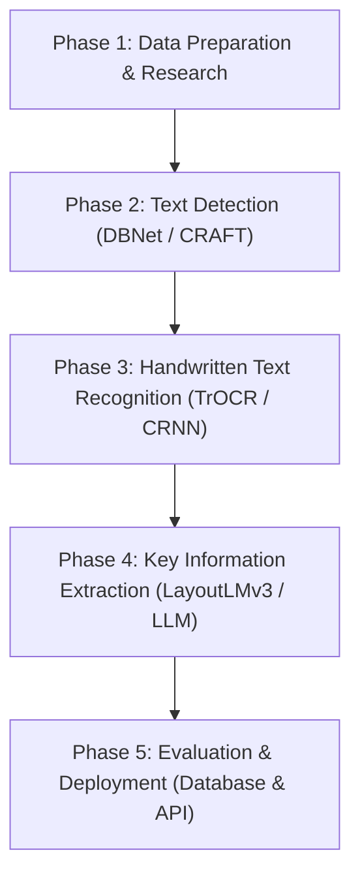

# Problem Understanding: Handwritten Receipt Recognition & Information Extraction System

---

## 1. Executive Summary

In many retail businesses, small shops, and day-to-day transactions, paper receipts are written by hand instead of being printed by computerized billing machines. Extracting information from these handwritten receipts manually is slow, tedious, and prone to human error.

The goal of this project is to build an **automated AI system** that takes an image of a handwritten receipt, detects and reads the handwritten text, and extracts key structured fields (such as Store Name, Date, Line Items, Prices, and Total Amount) into a clean digital format (e.g., JSON or SQL Database).

---

## 2. Problem Statement

Handwritten receipt processing presents a unique challenge for traditional Optical Character Recognition (OCR) tools. Unlike standard typed documents or digital PDFs:
- Receipts have **varying layouts** (table format, list format, key-value pairs).
- Handwriting styles differ greatly from person to person (cursive, print, slanted, faint).
- Receipts are often physical paper documents subject to **wrinkles, fading ink, poor lighting, and stains**.

### Why Automation is Needed:
1. **Time Consumption**: Manually entering receipt details into accounting software takes minutes per receipt.
2. **High Error Rate**: Human fatigue can lead to misreading numbers, dates, or prices.
3. **Lack of Searchability**: Paper receipts cannot be searched or queried easily for financial analysis or audit trails.

---

## 3. Project Objectives

1. **Text Region Detection**: Locate and crop all regions containing text on a handwritten receipt image.
2. **Handwritten Text Recognition (HTR)**: Convert cropped handwritten image segments into digital text strings accurately.
3. **Key Information Extraction (KIE)**: Identify key receipt fields automatically:
   - **Merchant / Store Name**
   - **Transaction Date & Time**
   - **Purchased Items & Quantities**
   - **Individual Prices**
   - **Subtotal & Total Amount**
4. **Structured Data Storage**: Save the extracted information into a structured database (SQL) for easy retrieval.
5. **System Evaluation & User Interface**: Measure model performance using standard metrics (Character Error Rate, F1-Score) and create a basic user interface or API for uploading receipts.

---

## 4. Key Challenges in Handwritten Receipt Recognition

| Challenge | Description | Impact on AI Model |
| :--- | :--- | :--- |
| **Handwriting Diversity** | Wide variation in pen pressure, slant, cursive connection, and illegible handwriting. | Misinterpretation of similar-looking letters (e.g., '0' vs 'O', '1' vs 'I' vs '7'). |
| **Document Degradation** | Faded ink, thermal paper discoloration, crumpling, folds, and coffee/oil stains. | Loss of edge contrast, making text detection and line segmentation difficult. |
| **Unstructured & Flexible Layouts** | Receipts lack a fixed template; items can appear in columns, lists, or unstructured blocks. | Traditional rule-based regex parsing fails when layout structures change. |
| **Low Resolution & Shadows** | Photos taken with mobile phones often have poor lighting, glare, or motion blur. | Image noise degrades OCR engine feature extraction. |
| **Overlapping & Crossed-Out Text** | Corrections made by hand, crossed-out numbers, or store rubber stamps overlapping text. | Causes false character detection or corrupted word strings. |

---

## 5. Proposed 5-Phase Project Workflow

### Breakdown of Phases:

1. **Phase 1: Data Preparation & Research** *(Current Phase)*
   - Explore existing datasets (SROIE, IAM, CORD, FUNSD).
   - Define data annotations and preprocessing requirements (image cleaning, deskewing).
   - Research open-source pretrained models on Hugging Face.

2. **Phase 2: Text Detection**
   - Implement computer vision models (e.g., DBNet or CRAFT) to draw bounding boxes around text lines and words on the receipt.

3. **Phase 3: Handwritten Text Recognition (HTR)**
   - Pass cropped text bounding boxes into sequence/transformer models (e.g., TrOCR or CRNN) to transcribe handwritten images into digital text.

4. **Phase 4: Information Extraction (KIE)**
   - Use layout-aware document models (e.g., LayoutLMv3) or vision LLMs to map recognized text into structured fields (`{ "store_name": "...", "total": "..." }`).

5. **Phase 5: Evaluation and Deployment**
   - Benchmark accuracy using **Character Error Rate (CER)** and **F1-Score**.
   - Store results in an SQL database and create a simple API/UI prototype.

---

## 6. Beginner's Glossary of Key Terms

- **OCR (Optical Character Recognition)**: Software technology that recognizes printed text characters in digital images.
- **HTR (Handwritten Text Recognition)**: A specialized branch of OCR optimized to recognize human handwriting.
- **Text Detection / Bounding Box**: The process of identifying the exact `(x, y, width, height)` coordinates of text inside an image.
- **KIE (Key Information Extraction)**: Extracting specific target entities (like "Date" or "Total") from unstructured text/documents.
- **CER (Character Error Rate)**: A metric measuring the percentage of incorrect characters produced by an OCR model. Lower is better.
- **WER (Word Error Rate)**: A metric measuring the percentage of incorrect words.
- **Layout-Aware Model**: An AI model that looks at both **the text words** and **their physical 2D location on the page** to understand document meaning.
